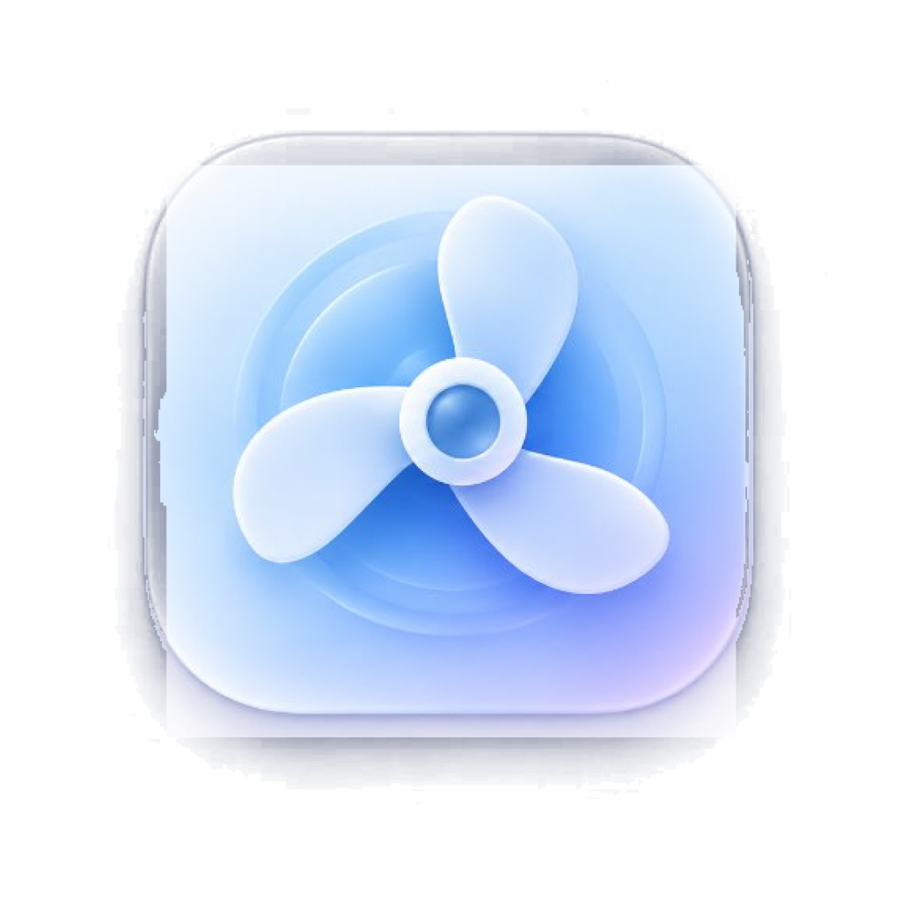
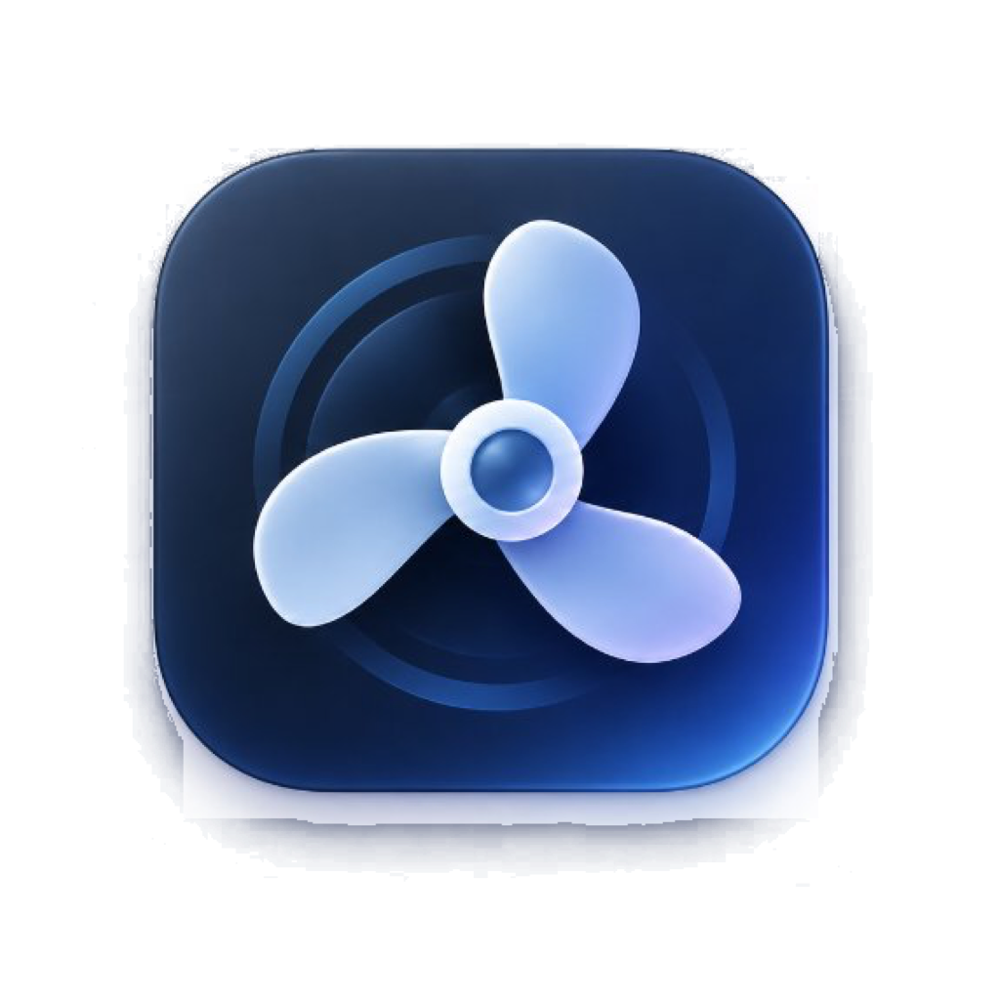

# Breeze 🌬️ — Apple Silicon Fan Control

<p align="center">
  
  
</p>
<p align="center">
  <i>Light Mode &nbsp; • &nbsp; Dark Mode</i>
</p>

<p align="center">
  <b>A minimalist, native Apple-style macOS menu bar application for fan control on Apple Silicon (M1/M2/M3/M4/M5 Pro).</b>
</p>

<p align="center">
  
  
  
  
</p>

---

## 🇵🇱 Opis / Overview

**Breeze** to lekka, minimalistyczna aplikacja stworzona z myślą o użytkownikach komputerów Apple Silicon (przetestowana m.in. na **Mac mini M5 Pro**). Program dyskretnie działa w górnym pasku menu (Menu Bar) i oferuje zaawansowaną kontrolę nad chłodzeniem komputera przy zachowaniu pełnego bezpieczeństwa sprzętowego.

---

## 🎯 Profile chłodzenia / Cooling Profiles

| Profil | Zastosowanie (*Best for*) | Opis działania |
| :--- | :--- | :--- |
| **System** | *Lets macOS manage the fans.* | Domyślna regulacja Apple Silicon SMC i CLPC. macOS sam kontroluje obroty. |
| **System+** | *Gentle, earlier airflow for everyday use.* | Spokojny, wczesny przepływ powietrza (~1700 RPM). Zapobiega nagrzewaniu obudowy podczas codziennej pracy biurowej. |
| **Cool Chassis** | *Keeps the typing area cool and comfortable.* | Utrzymuje chłodną obudowę (~2400 RPM bazowo), proaktywnie chłodząc radiator. |
| **Gaming** | *Very early and stronger cooling during sustained loads.* | Wczesne i mocniejsze chłodzenie (~3400 RPM bazowo) eliminujące thermal throttling w grach i kompilacji. |
| **Silent** | *Keeps the fans slower for quiet environments.* | Priorytet absolutnej ciszy (1000–1200 RPM) z automatyczną ochroną awaryjną powyżej 85°C. |
| **Max** | *Runs each fan at its maximum.* | 100% maksymalnej wydajności wentylatora (~4900 RPM na Mac mini M5 Pro). |
| **Custom Profiles** | *Create your own cooling curves.* | Edytor własnych krzywych termicznych: temperatura startu, temperatura maks., obroty bazowe i docelowe. |

---

## 🛡️ Bezpieczeństwo Sprzętowe / Hardware Safety Architecture

Aplikacja została zaprojektowana z zachowaniem rygorystycznych standardów bezpieczeństwa:

1. **Acoustic Stabilization (Brak "falowania" obrotów)**:
   * **EMA Low-pass Filter**: Zamiast reagować na chwilowe 100ms skoki rdzenia krzemowego (`TCMb`), aplikacja łączy odczyty procesora z temperaturą radiatora (`TH0a`) i wygładza je filtrem EMA.
   * **Slew-Rate Limiting**: Ograniczenie tempa zmian obrotów (maks. 50–70 RPM na sekundę przy schładzaniu).
   * **Hysteresis Hold Time**: Po wzroście obrotów wentylator utrzymuje wyższy bieg przez min. 7 sekund przed powolnym zejściem, co całkowicie eliminuje irytujące "falowanie" głośności.
2. **Watchdog Heartbeat w Daemonie**:
   * Daemon pomocniczy (`breeze-helper`) monitoruje stan połączenia. Jeśli aplikacja ulegnie awarii lub zostanie wymuszona jej likwidacja (`kill -9`), daemon po **30 sekundach braku sygnału automatycznie przywraca fabryczny tryb Apple System (`F0md = 0`)**.
3. **Signal Trapping**:
   * Zarejestrowane procedury obsługi sygnałów `SIGINT`, `SIGTERM` i `SIGHUP` w aplikacji natychmiast przywracają tryb systemowy przed zamknięciem.
4. **Thermal Panic Emergency Override**:
   * Jeśli jakikolwiek sensor przekroczy temperaturę krytyczną **86.0°C**, aplikacja automatycznie ignoruje aktywny profil (nawet *Silent*) i wymusza natychmiast 100% chłodzenia do czasu ustabilizowania temperatur.
5. **Hardware Boundary Clamping**:
   * Obroty są ściśle ryglowane w sprzętowym zakresie Apple Silicon (dla Mac mini M5 Pro: `[1000 RPM, 4900 RPM]`).

---

## 📦 Instalacja / Installation

### 1. Pobranie i instalacja z pliku DMG
Gotowy instalator znajduje się w pliku:
`Breeze-1.0.0.dmg`

1. Otwórz `Breeze-1.0.0.dmg`.
2. Przeciągnij **Breeze.app** do folderu **Applications**.
3. Kliknij dwukrotnie w dołączony skrypt **Install Privileged Helper.command** (lub zainstaluj helper z okna `Settings` w aplikacji).

---

## 🐙 Jak wrzucić na GitHub / Push to GitHub

Repozytorium Git zostało zainicjalizowane lokalnie. Aby opublikować je na swoim koncie GitHub:

```bash
cd /Users/dominik/.gemini/antigravity/scratch/Breeze

# 1. Utwórz nowe repozytorium na github.com (np. o nazwie "Breeze")
# 2. Podłącz zdalne repozytorium (zastąp YOUR_USERNAME swoją nazwą użytkownika):
git remote add origin https://github.com/YOUR_USERNAME/Breeze.git

# 3. Zmień nazwę gałęzi na main i wyślij kod:
git branch -M main
git push -u origin main
```

---

## 📁 Struktura Projektu / Project Structure

```text
Breeze/
├── Breeze-1.0.0.dmg                # Gotowy instalator macOS DMG
├── Breeze.app/                     # Gotowa paczka aplikacji Menu Bar
├── AppIcon_preview.png             # Podgląd ikony Liquid Glass (512x512)
├── AppIcon.icns                    # Natywna ikona macOS
├── Sources/
│   ├── Breeze/
│   │   ├── AppDelegate.swift       # Cykl życia, rejestracja sygnałów SIGINT/SIGTERM
│   │   ├── main.swift              # Punkt startowy NSApplication
│   │   ├── SMC/
│   │   │   └── SMCEngine.swift     # IOKit AppleSMC, filtr EMA i ważone sensory
│   │   ├── Models/
│   │   │   └── FanProfile.swift    # Skalibrowane profile termiczne i krzywe
│   │   ├── Services/
│   │   │   ├── FanManager.swift    # Kontroler slew-rate, histereza, watchdog failsafe
│   │   │   └── HelperClient.swift  # Komunikacja IPC przez /var/run/breeze.sock
│   │   └── UI/
│   │       ├── MenuBarController.swift # Ikona Apple-style, menu status bar
│   │       ├── GaugeMenuItemView.swift # Wskaźnik postępu obrotów w menu
│   │       ├── SettingsWindowController.swift # Kontroler okna ustawień
│   │       └── Views/
│   │           ├── ProfileEditorView.swift    # Edytor krzywych i wykres
│   │           └── SettingsView.swift         # Ustawienia, sensory, instalacja daemona
│   └── Helper/
│       └── main.swift              # Daemon launchd z 30s watchdogiem bezpieczeństwa
└── scripts/
    ├── build.sh                    # Kompilacja aplikacji i daemona
    ├── create-dmg.sh               # Tworzenie obrazu instalacyjnego DMG
    ├── generate_icon.swift         # Generator ikony Liquid Glass
    └── install-helper.sh           # Instalator daemona launchd
```
